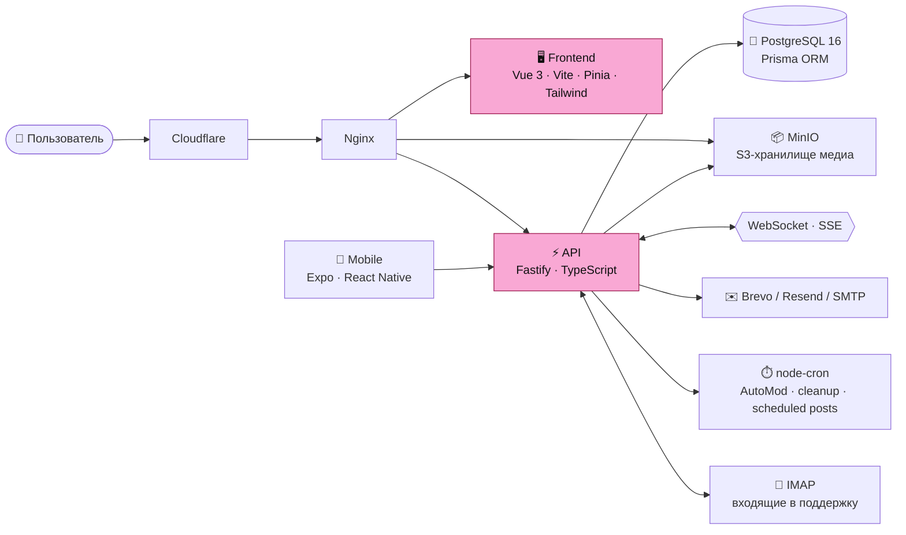

<div align="center">


<br />

# 🌸 Bloomly

### Социальная сеть и маркетплейс для творческих сообществ

**Арт · Косплей · Музыка · Фурсьюты · Фестивали**
Место, где творцы публикуют работы, находят своих людей и продают свой труд — безопасно, в одном месте.

<br />

[](https://vuejs.org)
[](https://fastify.dev)
[](https://www.typescriptlang.org)
[](https://www.prisma.io)
[](https://www.postgresql.org)
[](https://expo.dev)
[](https://www.docker.com)

[**🌐 bloomly.fun**](https://bloomly.fun) · [Возможности](#-возможности) · [Dealers' Den](#-dealers-den--маркетплейс-со-встроенным-доверием) · [Архитектура](#-архитектура) · [Быстрый старт](#-быстрый-старт)

</div>

---

## ✨ Что такое Bloomly

Bloomly — это не очередная копия большой соцсети. Это платформа, **заточенная под творческие субкультуры**: у неё свой язык (перелапить вместо репоста), свои сущности (фурсоны, фурсьюты, фестивали, комиссии) и своя экономика.

Главная идея: **весь путь от «понравилась работа» до «сделка закрыта» происходит внутри платформы**, и обе стороны защищены. Не нужно искать художника на одной площадке, договариваться в мессенджере и платить через третью.

<table>
<tr>
<td width="25%" align="center"><h3>🎨</h3><b>Контент</b><br/>посты, сторис, закладки, отложенные публикации</td>
<td width="25%" align="center"><h3>👥</h3><b>Сообщества</b><br/>группы, фестивали, билеты, мероприятия</td>
<td width="25%" align="center"><h3>🛒</h3><b>Экономика</b><br/>Dealers' Den, кошелёк, магазин, подписки</td>
<td width="25%" align="center"><h3>🛡️</h3><b>Безопасность</b><br/>2FA, E2E-чаты, AutoMod, верификация</td>
</tr>
</table>

## 📊 Проект в цифрах

| | |
|---|---|
| 🧩 **26** backend-модулей | модульный монолит, каждый домен изолирован |
| 🗄️ **87** моделей Prisma | **133** миграции — история эволюции схемы |
| 🔌 **400+** API-эндпоинтов | REST + WebSocket |
| 🖥️ **34** страницы и **70+** компонентов | Vue 3 + TypeScript |
| 🌍 **8** языков интерфейса | RU · EN · JP · CN · DE · FR · ES · PT |
| 📱 **Мобильное приложение** | Expo + React Native, 5 основных вкладок |
| ⏱️ **8** фоновых cron-задач | автомодерация, очистка медиа, отложенные посты |

---

## 🚀 Возможности

### 🖼️ Контент и лента

- **Посты** с медиа, тегами, категориями (Digital Art, фотография, 3D, анимация, тексты) и NSFW-разметкой с возрастным ограничением
- **Перелапить (Repaw)** — собственная механика репостов, **избранное** и закладки с **пользовательскими метками**
- **Сторис** с просмотрами и голосованием, собственный просмотрщик
- **Отложенные публикации** — запланируйте пост заранее, cron опубликует его вовремя
- **Персональная лента** на основе аффинити к тегам (`UserTagAffinity`), без чёрного ящика
- **Комментарии** с ответами и голосами, упоминания (`@`) и редактор с форматированием
- **Богатые медиа:** кастомный видеоплеер, мини-плеер, лайтбокс, автоочистка осиротевших файлов

### 👤 Профили

- **Фурсоны** с референс-картинками и **фурсьюты** — отдельные сущности профиля
- **Рамки аватара** с редактором и системой отправки на модерацию
- **Бейджи верификации**, заявки на статус, индикатор заполненности профиля
- Приватность профиля, блокировки, друзья, подписки и запросы отношений

### 💬 Общение

- **Личные сообщения** с ключами беседы AES-256, зашифрованными публичным RSA-OAEP-ключом каждого участника
- **WebSocket**-доставка в реальном времени и SSE-уведомления
- **Стикеры:** паки, коллекции, избранное, статистика использования, **анимированные (Lottie)** и **импорт паков из Telegram** в один клик

### 🏕️ Группы, события и фестивали

Три типа сообществ: `event`, `creative` и `static`.

- Собственные **роли**, рейтинги, транзакции и заказы внутри группы
- **Todo-списки группы** со статусами и назначением задач
- **События** с картой (координаты), подсобытиями, **тирами билетов** (цена, лимит, окно продаж, перки), бейджами «скоро» и списком участников
- **Активности** с заявками участников, чёрным списком и очередью одобрения
- **Группы-бизнесы** и страница инструментов администратора группы

### 💎 Экономика

- **Кошелёк** с пополнением, **магазин** предметов, **подписки** с планами и способами оплаты
- **Dealers' Den** — полноценный маркетплейс (см. ниже)

---

## 🏪 Dealers' Den — маркетплейс со встроенным доверием

> **Главное конкурентное преимущество Bloomly:** вся жизнь сделки — от лота до отзыва — проходит в одной защищённой цепочке, а не размазана по трём площадкам.

| Формат лота | Что это |
|---|---|
| 🏷️ **fixed** | обычная продажа по фиксированной цене |
| 🔨 **auction** | аукцион со ставками (`DealerBid`) |
| 🎟️ **ych** | «Your Character Here» — слоты под персонажа покупателя |
| 🎲 **raffle** | розыгрыши |
| 📋 **commission_queue** | очередь комиссий с позицией, формой заявки и статусами |

**Что делает Den особенным:**

- 🏅 **Den Trust Score** — рейтинг продавца считается из закрытых сделок, средней оценки и проигранных споров. Пять уровней статуса:

  ```
  new  →  reliable  →  verified  →  master  →  elite
  ```

  Для `elite` нужно 200+ сделок и скор от 95. Репутацию нельзя купить — только заработать.
- ⭐ **Отзывы и теги** — структурированные оценки сделок
- ⚖️ **Споры** — открытие, ответ продавца, решение модератора; споры без ответа продавца закрываются автоматически
- 🧡 **Вишлисты** и уведомления об интересующих лотах
- 🏆 **Недельный топ** продавцов
- 🎪 **Ярмарки (Den Fair)** — тематические сезонные мероприятия с участниками
- 🔞 Корректная работа с NSFW-лотами и возрастными ограничениями

---

## 🛡️ Безопасность и модерация

<table>
<tr>
<td valign="top" width="50%">

**Аккаунт**

- Access + refresh токены с **ротацией**, refresh хранится в БД
- **2FA:** TOTP (QR-код) и код на email; секреты шифруются
- **OAuth:** Google, Yandex, X (Twitter), Twitch
- Email-OTP для регистрации, сброса пароля и смены почты
- Заморозка аккаунта с возможностью разморозки
- Rate-limiting на всех маршрутах

</td>
<td valign="top" width="50%">

**Модерация**

- **AutoMod** с рейтингом нарушений: `spam · toxic · duplicate · fraud · suspicious`
- Эскалация `warn → freeze` — **автоматический бан намеренно отключён**, финальное решение за человеком
- **Апелляции** предупреждений
- Жалобы, админ-панель, рассылки, глобальные настройки сайта и режим техработ
- **Support-система:** письма из IMAP превращаются в тикеты, ответы уходят по SMTP

</td>
</tr>
</table>

---

## 🏗️ Архитектура

Bloomly — **модульный монолит**: один деплой, но каждый домен живёт в своей папке со своими routes → controller → service → types. Никаких микросервисов и лишней сложности.



### Структура репозитория

```
bloomly_mvp/
├── backend/                 ⚡ Fastify + Prisma + TypeScript
│   ├── prisma/              87 моделей, 133 миграции
│   └── src/
│       ├── modules/         26 доменных модулей
│       │   ├── auth/  users/  posts/  stories/  comments…
│       │   ├── groups/  activities/  events…
│       │   ├── dealers-den/ (service · trust · fair)
│       │   ├── stickers/  avatar-frames/  shop/  wallet/
│       │   ├── messages/  notifications/  friends/  follows/
│       │   └── automod/  verification/  support/  admin/
│       ├── lib/             privacy, блокировки, роли, санитайзинг, TOTP
│       ├── scripts/         бэкфиллы и очистка медиа
│       └── cron.ts          фоновые задачи
│
├── frontend/                🖥️ Vue 3 SPA
│   └── src/  views · components · stores · composables · locales
│
├── mobile/                  📱 Expo Router + NativeWind + Zustand
│   └── app/  (tabs) feed · discover · groups · messages · profile
│
└── docker-compose.yml       🐳 db · api · frontend · minio
```

### Принципы, на которых всё держится

| Принцип | Как это выглядит |
|---|---|
| 🧱 **Модульность** | изменения затрагивают только свой модуль, без «скрытых» связей |
| 🗑️ **Soft delete** | `deleted_at` на таблицах, физическое удаление только в ночной очистке |
| 🆔 **UUID везде** | никаких автоинкрементов и угадываемых ID |
| 🔐 **Ротация токенов** | refresh-токены хранятся в БД и обновляются при каждом использовании |
| 🧪 **Типы от БД до UI** | Prisma → TypeScript → Vue с `vue-tsc` |

---

## 🧰 Стек

| Слой | Технологии |
|---|---|
| **Frontend** | Vue 3 · TypeScript · Vite · Pinia · Vue Router · Tailwind CSS · Lottie · Heroicons / Lucide |
| **Backend** | Node.js 20 · Fastify 4 · Prisma 5 · `@fastify/jwt` · `@fastify/websocket` · `@fastify/rate-limit` |
| **База данных** | PostgreSQL 16 (с data-checksums и тюнингом под нагрузку) |
| **Хранилище** | MinIO (S3-совместимое) · Sharp · FFmpeg |
| **Mobile** | Expo · React Native · Expo Router · NativeWind · TanStack Query · Zustand · Reanimated |
| **Почта** | Brevo / Resend / Nodemailer · IMAP-поллер для поддержки |
| **Инфраструктура** | Docker Compose · Nginx · Cloudflare · self-hosted VPS |

---

## ⚡ Быстрый старт

### Требования

- Docker и Docker Compose
- Node.js 20+ (если запускаете без Docker)

### 1. Клонирование

```bash
git clone https://github.com/FoxTaffy/Bloomly_MVP.git
cd Bloomly_MVP
```

### 2. Конфигурация

Создайте файл `.env` в корне проекта:

```env
# База данных
POSTGRES_USER=postgres
POSTGRES_PASSWORD=<сильный-пароль>
POSTGRES_DB=bloomly
DATABASE_URL=postgresql://postgres:<сильный-пароль>@db:5432/bloomly

# Безопасность
JWT_SECRET=<случайная-строка>
COOKIE_SECRET=<случайная-строка>
TWO_FACTOR_ENCRYPTION_KEY=<ключ-для-шифрования-2FA>
ALLOWED_ORIGINS=https://your-domain.com

# Хранилище
MINIO_ROOT_USER=<логин>
MINIO_ROOT_PASSWORD=<пароль>
MINIO_PUBLIC_URL=https://your-domain.com/s3

# Приложение
FRONTEND_URL=https://your-domain.com
OAUTH_REDIRECT_BASE=https://your-domain.com/api
```

<details>
<summary><b>Необязательные интеграции</b></summary>

```env
# Почта
BREVO_API_KEY=
EMAIL_FROM="Bloomly <noreply@your-domain.com>"

# OAuth
GOOGLE_CLIENT_ID=      GOOGLE_CLIENT_SECRET=
YANDEX_CLIENT_ID=      YANDEX_CLIENT_SECRET=
TWITTER_CLIENT_ID=     TWITTER_CLIENT_SECRET=
TWITCH_CLIENT_ID=      TWITCH_CLIENT_SECRET=

# Telegram (импорт стикерпаков)
TELEGRAM_BOT_TOKEN=

# Почта поддержки (тикеты из входящих писем)
SUPPORT_EMAIL_ADDRESS=
SUPPORT_IMAP_HOST=  SUPPORT_IMAP_PORT=  SUPPORT_IMAP_USER=  SUPPORT_IMAP_PASS=
SUPPORT_SMTP_HOST=  SUPPORT_SMTP_PORT=  SUPPORT_SMTP_USER=  SUPPORT_SMTP_PASS=

# Оплата через ЮMoney (подписка и пополнение баланса). Пока пусто — оплата выключена
YOOMONEY_RECEIVER=             # номер кошелька 41001…
YOOMONEY_NOTIFICATION_SECRET=  # секрет HTTP-уведомлений
```

</details>

<details>
<summary><b>Подключение ЮMoney</b></summary>

1. В кошельке ЮMoney откройте [HTTP-уведомления](https://yoomoney.ru/transfer/myservices/http-notification):
   - адрес: `https://<ваш-домен>/api/payments/yoomoney/notify` (только HTTPS);
   - скопируйте «секрет» в `YOOMONEY_NOTIFICATION_SECRET`, номер кошелька — в `YOOMONEY_RECEIVER`;
   - нажмите «Протестировать» — API ответит `200 OK` (тестовое уведомление ничего не зачисляет).
2. Перезапустите backend. `GET /api/payments/config` должен вернуть `enabled: true`.
3. Сделайте пробное пополнение на 50 ₽ и проверьте статус платежа в `GET /api/payments/admin?status=review`.

Как это работает: сервер создаёт `Payment` и уводит пользователя на форму Quickpay с `label = id платежа`.
Зачисление — только по уведомлению с верной sha1-подписью; повторы идемпотентны. Если сумма меньше
ожидаемой или деньги заморожены (`unaccepted`), платёж уходит в статус `review` для ручного разбора.
Подписка — предоплаченный период (месяц/год), без автосписаний; истёкшие сбрасывает cron.
Цены — `backend/src/modules/payments/pricing.ts` (держите в синхроне с `SubscriptionView.vue`).
В dev оплату можно подтвердить без шлюза: `POST /api/payments/:id/dev-confirm`.

</details>

> ⚠️ Перед выходом в продакшн обязательно замените все значения по умолчанию из `docker-compose.yml` на собственные секреты.

### 3. Запуск

```bash
docker compose up -d --build
```

API при старте сам применит миграции (`prisma migrate deploy`). После запуска:

| Сервис | Адрес (только localhost) |
|---|---|
| Frontend | `127.0.0.1:5173` |
| API | `127.0.0.1:8080` |
| MinIO Console | `127.0.0.1:9001` |

Наружу сервисы публикуются через Nginx с Cloudflare: порты привязаны к `127.0.0.1` намеренно.

### Локальная разработка

```bash
# Backend
cd backend
npm install
npx prisma generate
npx prisma migrate dev
npm run db:seed          # тестовые данные
npm run dev

# Frontend
cd frontend
npm install
npm run dev

# Mobile
cd mobile
npm install
npm start                # затем: npm run android / npm run ios
```

### Полезные команды

```bash
npm run db:backfill-tag-affinity       # пересчёт аффинити тегов для ленты
npm run db:cleanup-orphaned-media      # удалить файлы без владельца
npm run db:cleanup-deleted-media       # удалить медиа удалённых записей
npm run typecheck                      # проверка типов (frontend / mobile)
```

---

## ⏱️ Фоновые задачи

| Частота | Что делает |
|---|---|
| каждую минуту | публикация отложенных постов, опрос почтового ящика поддержки |
| каждые 5 мин | keepalive соединения с БД |
| каждые 15 мин | патруль подозрительной активности (AutoMod) |
| ежечасно | автоурегулирование споров Dealers' Den, на которые продавец не ответил |
| ежедневно, 03:00 | очистка мягко удалённого контента старше 30 дней вместе с файлами в S3 |
| ежедневно, 04:00 | обработка просроченных участников активностей |

---

## 🗺️ Дорожная карта

- [x] Социальное ядро: посты, сторис, комментарии, подписки
- [x] Группы, события, билеты, активности
- [x] Dealers' Den: лоты, аукционы, комиссии, Trust Score, споры, ярмарки
- [x] Стикеры, рамки аватара, магазин, кошелёк
- [x] 2FA, E2E-чаты, AutoMod, верификация
- [x] 8 языков интерфейса
- [ ] Мобильное приложение: паритет с веб-версией
- [ ] Расширение Dealers' Den: пакеты лотов, сезонные бейджи продавцов

---

## 🕰️ История

Первая версия — [**Bloomly v1**](https://github.com/FoxTaffy/Bloomly) — работала на Vue 3 + Express + PostgreSQL с универсальным CRUD-слоем. Этот репозиторий — полная переработка: типизированный бэкенд на Fastify и Prisma, модульная архитектура, мобильное приложение и экономика с защитой сделок.

---

<div align="center">

**Сделано с 🧡 для творцов**

[bloomly.fun](https://bloomly.fun)

</div>
