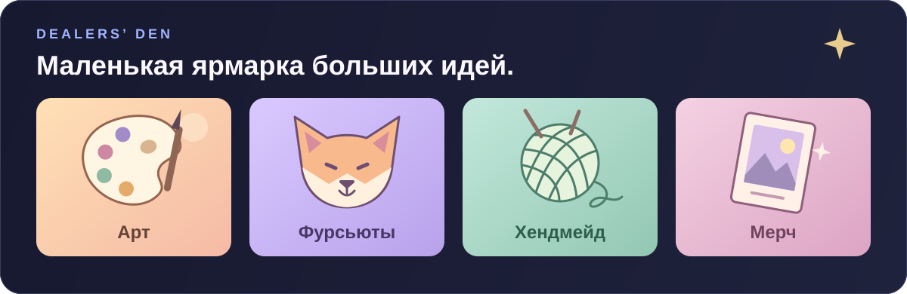

  <picture>
    <source media="(max-width: 640px)" srcset="assets/hub-header-mobile.svg" />
    
  </picture>

<h1 align="center">Твоё творчество. Твои люди.</h1>

<strong>Социальная сеть для тех, кто создаёт. И тех, кто ценит.</strong> 
Показывай работы, находи друзей и развивай своё дело в творческом сообществе.

Арт · Фурри · Косплей · Музыка · Хендмейд · Фестивали

  
  
  
  

  
  
  

 

## Возможности

Твой новый персонаж, первый костюм, любимая история или работа, над которой ты трудился месяцами, — у всего этого есть место в Bloomly.

<table>
  <tr>
    <td width="50%" valign="top">
      <h3>Показывай работы</h3>
      
Арты, фотографии, видео, музыка и тексты. Делись результатом и процессом, собирай отклики и сохраняй вдохновение.

    </td>
    <td width="50%" valign="top">
      <h3>Собирай сообщество</h3>
      
Вступай в группы по интересам или создай свою. Обсуждай идеи, знакомься с авторами и придумывай совместные проекты.

    </td>
  </tr>
  <tr>
    <td width="50%" valign="top">
      <h3>Будь на связи</h3>
      
Личные сообщения, комментарии и стикеры помогают продолжить знакомство за пределами ленты.

    </td>
    <td width="50%" valign="top">
      <h3>Расскажи о себе</h3>
      
Оформи профиль, покажи своих персонажей и фурсьюты. Пусть тебя узнают по тому, что тебе близко.

    </td>
  </tr>
  <tr>
    <td width="50%" valign="top">
      <h3>Найди своего мастера</h3>
      
Открывай авторские вещи, выбирай работы и заказывай у творцов через Dealers’ Den.

    </td>
    <td width="50%" valign="top">
      <h3>Встречайся вживую</h3>
      
Следи за событиями и фестивалями, узнавай об активностях и планируй встречи с сообществом.

    </td>
  </tr>
</table>

Понравилась работа? **«Перелапь» её** — так в Bloomly делятся находками.

 

## Dealers’ Den

<a href="https://bloomly.fun/dealers-den">
  <picture>
    <source media="(max-width: 640px)" srcset="assets/dealers-den-mobile.svg" />
    
  </picture>
</a>

**Увидел работу. Нашёл автора. Создал что-то своё.**

Dealers’ Den — творческая ярмарка внутри Bloomly. Здесь встречаются художники, мастера и люди, которые ищут особенные вещи.

- **Готовые работы и заказы** — иллюстрации, фурсьюты, крафт, принты и мерч.
- **Разные форматы** — обычные продажи, аукционы и очередь заказов у автора.
- **Знакомство до заказа** — профиль мастера, отзывы и репутация помогают сделать выбор.

 

## Найди своих

Необязательно быть профессиональным художником. Можно шить первый костюм, придумывать персонажей, писать музыку, собирать любимые арты или просто искать людей с похожими увлечениями.

**В Bloomly есть место и авторам, и их аудитории.**

1. **Расскажи о себе** — оформи профиль и поделись интересами.
2. **Найди то, что нравится** — посмотри работы и сообщества.
3. **Начни общение** — оставь комментарий, подпишись или покажи своё творчество.

 

  
  

 

## Новости и обновления

<table>
  <tr>
    <td width="50%" valign="top">
      <h3>Жизнь сообщества</h3>
      
Важные объявления, события и всё, чем хочется поделиться с людьми Bloomly.

      
<a href="https://github.com/FoxTaffy/Bloomly_MVP/issues/21">Остаёмся на связи</a>

      

    </td>
    <td width="50%" valign="top">
      <h3>Что стало лучше</h3>
      
Новые возможности, изменения и исправления — с объяснением, что это даёт тебе.

      
<a href="https://github.com/FoxTaffy/Bloomly_MVP/issues/22">Знакомься с новым хабом</a>

      

    </td>
  </tr>
</table>

Короткие анонсы можно читать в Telegram, а обсуждать новости и обновления — здесь.

 

## Помоги Bloomly стать лучше

Что-то не загрузилось, кнопка не сработала или страница выглядит странно? Расскажи об этом: твои наблюдения помогают сделать Bloomly удобнее.

В форме достаточно описать, **что случилось**, **как это повторить** и **на каком устройстве**. Если можешь, добавь скриншот. После отправки в теме можно следить за статусом и отвечать на уточнения команды.

 

 

  
  
Творчество начинается с идеи. Сообщество — с тебя.

  
  
Новости, обновления и обратная связь — на GitHub Bloomly.

Для разработчиков

[Техническая документация проекта](README_DEVELOPMENT.md)

