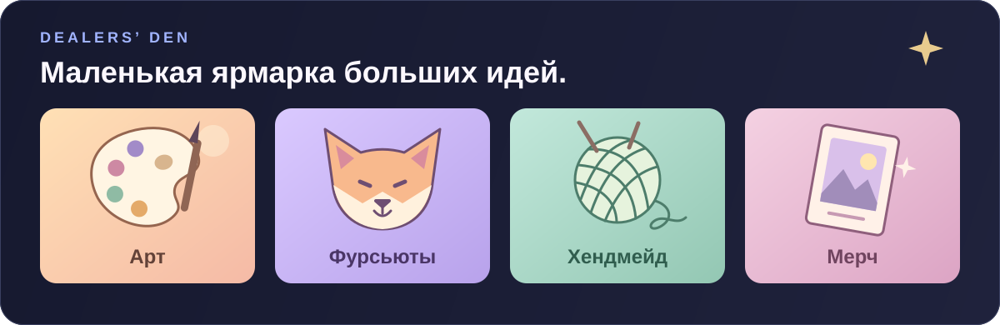
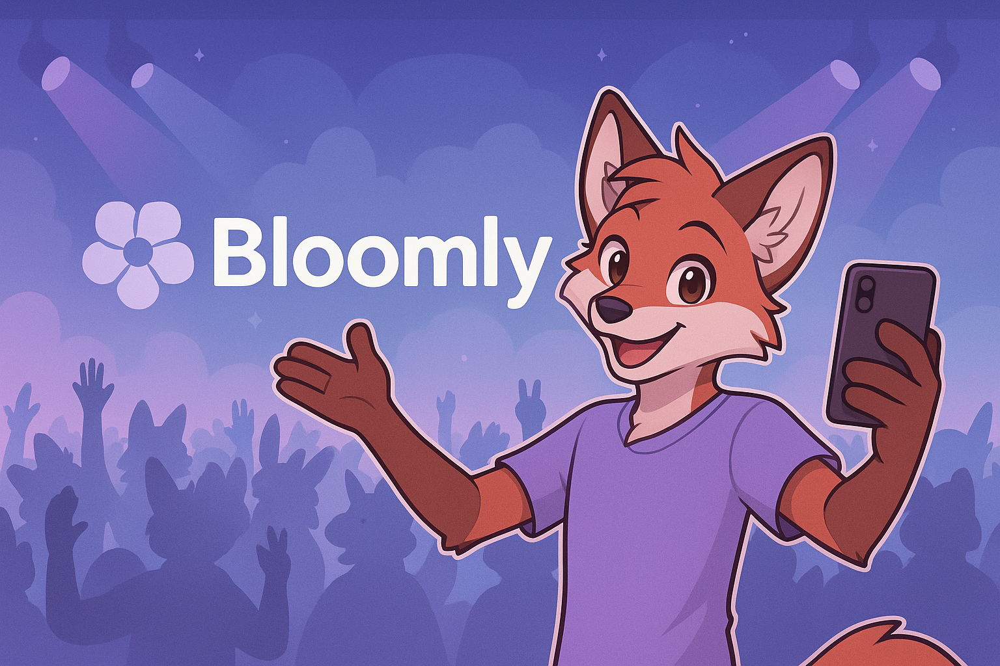
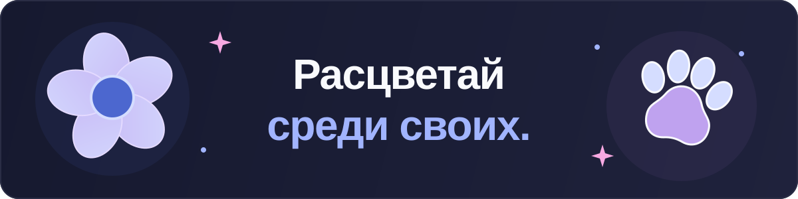

  <picture>
    <source media="(max-width: 640px)" srcset="assets/hub-header-mobile.svg" />
    
  </picture>

<h1 align="center">Твоё творчество. Твои люди.</h1>

<strong>Социальная сеть для тех, кто создаёт. И тех, кто ценит.</strong> 
Показывай работы, находи друзей и развивай своё дело в творческом сообществе.

Арт · Фурри · Косплей · Музыка · Хендмейд · Фестивали

  
  
  
  

  
  
  

 

## Возможности

Твой новый персонаж, первый костюм, любимая история или работа, над которой ты трудился месяцами, — у всего этого есть место в Bloomly.

<table>
  <tr>
    <td width="50%" valign="top">
      <h3>Показывай работы</h3>
      
Арты, фотографии, видео, музыка и тексты. Делись результатом и процессом, собирай отклики и сохраняй вдохновение.

    </td>
    <td width="50%" valign="top">
      <h3>Собирай сообщество</h3>
      
Вступай в группы по интересам или создай свою. Обсуждай идеи, знакомься с авторами и придумывай совместные проекты.

    </td>
  </tr>
  <tr>
    <td width="50%" valign="top">
      <h3>Будь на связи</h3>
      
Личные сообщения, комментарии и стикеры помогают продолжить знакомство за пределами ленты.

    </td>
    <td width="50%" valign="top">
      <h3>Расскажи о себе</h3>
      
Оформи профиль, покажи своих персонажей и фурсьюты. Пусть тебя узнают по тому, что тебе близко.

    </td>
  </tr>
  <tr>
    <td width="50%" valign="top">
      <h3>Найди своего мастера</h3>
      
Открывай авторские вещи, выбирай работы и заказывай у творцов через Dealers’ Den.

    </td>
    <td width="50%" valign="top">
      <h3>Встречайся вживую</h3>
      
Следи за событиями и фестивалями, узнавай об активностях и планируй встречи с сообществом.

    </td>
  </tr>
</table>

Понравилась работа? **«Перелапь» её** — так в Bloomly делятся находками.

 

## Dealers’ Den

<a href="https://bloomly.fun/dealers-den">
  <picture>
    <source media="(max-width: 640px)" srcset="assets/dealers-den-mobile.svg" />
    
  </picture>
</a>

**Увидел работу. Нашёл автора. Создал что-то своё.**

Dealers’ Den — творческая ярмарка внутри Bloomly. Здесь встречаются художники, мастера и люди, которые ищут особенные вещи.

- **Готовые работы и заказы** — иллюстрации, фурсьюты, крафт, принты и мерч.
- **Разные форматы** — обычные продажи, аукционы и очередь заказов у автора.
- **Знакомство до заказа** — профиль мастера, отзывы и репутация помогают сделать выбор.

 

## Найди своих

Необязательно быть профессиональным художником. Можно шить первый костюм, придумывать персонажей, писать музыку, собирать любимые арты или просто искать людей с похожими увлечениями.

**В Bloomly есть место и авторам, и их аудитории.**

1. **Расскажи о себе** — оформи профиль и поделись интересами.
2. **Найди то, что нравится** — посмотри работы и сообщества.
3. **Начни общение** — оставь комментарий, подпишись или покажи своё творчество.

 

  
  

 

## Интересное

### Мероприятия

Фурри-фестивали, конвенции, маркеты и сходки — где их искать и как попасть. Ссылки ведут на каналы и сообщества организаторов, где публикуются анонсы.

<strong>Фестивали</strong>

- [AnyFurry fest](https://t.me/anyfurry_fest)
- DraCon — [VK](https://vk.ru/dracon) · [Telegram](https://t.me/DraCon_Official)
- [Fox Family fest](https://vk.ru/ff_fest)
- [Forest fest](https://vk.ru/forest_fest_moscow)
- [FurrBurg](https://t.me/furrburgfest)

<strong>Мультифандомные и большие фестивали</strong>

- [Акамару Фест](https://vk.ru/akamarufest)
- [Epiccon](https://t.me/epicconrussia)
- [Comic Con Игромир](https://t.me/comicconigromir)
- [МанГАЛА понифест](https://t.me/nightmare_pony_night)
- [Зоофест ЭКО](https://t.me/animarket_msk)

<strong>Маркеты</strong>

- [ФурМаркет](https://t.me/furr_market)
- [Артмаркет Зверей](https://t.me/zvereymarket)
- [Дикий маркет](https://t.me/dikiy_market)
- [AniMarket](https://t.me/animarket_msk)
- [I luv it](https://t.me/i_luv_it_market)
- [Кико арт-маркет](https://t.me/kiko_market)

<strong>Конвенции</strong>

- [2pCon](https://t.me/SillyConNews)
- [FoxWood](https://t.me/foxwoodnews)
- [UFC](https://t.me/united_furry_con)
- [SkyFurr](https://t.me/SkyFurr_News_Today)
- [Furmeetage](https://t.me/furmeetage)
- [HellTedge](https://t.me/hellcottage)
- [WildFurry](https://t.me/wfinfo)
- [Волкистан](https://t.me/wolkistan)
- ГП, BBFC, TourFurr, Puffycon, WinterTails — официальных ссылок пока нет

<strong>Лофт-тусовки, сходки и встречи</strong>

- Лофт-тусовки: [TailsSquad](https://t.me/TailsSquadNews)
- Сходки: [Фурри-встречи в Москве](https://t.me/furryevent)
- Сходки с ивентами, квестами и активностями: [Тотемный столб](https://t.me/totempolemoscow)

<strong>Знакомства и карты</strong>

- [Знакомства Фурри](https://t.me/furry_4)
- [Фурри-сайт с картой фуррей](https://m-fur.ru/)
- [Blink](https://blinkmap.com/ru) — геолокация онлайн: фурри добавляются, чтобы находить друг друга и договариваться о кооперациях
- [Фурри-календарь ивентов](https://horseyspirit-cmyk.github.io/cosmopolite.github.io/) — добавлены не все события, но главные есть

<strong>Ещё не проверено: маркеты и фестивали вне фурри-тусовки</strong>

Не все из этих площадок ориентированы на фурри — загляни и оцени сам.

**Маркеты:** [hokkumarket](https://vk.ru/hokkumarket) · [gnezdo_original](https://vk.ru/gnezdo_original) · [artfestzarya](https://vk.ru/artfestzarya) · [fichamarket](https://vk.ru/fichamarket) · [lookartmarket](https://vk.ru/lookartmarket) · [creepymarket](https://vk.ru/creepymarket) · [gnezd0market](https://vk.ru/gnezd0market) · [time_artmarket](https://vk.ru/time_artmarket) · [consol_artmarket](https://vk.ru/consol_artmarket) · [razryad_msk](https://vk.ru/razryad_msk) · [connectartmarket](https://vk.ru/connectartmarket) · [hell_market](https://vk.ru/hell_market) · [zhil_byl_market](https://vk.ru/zhil_byl_market) · [starmarkett](https://vk.ru/starmarkett) · [supermarket_market](https://vk.ru/supermarket_market) · [kusmarketart](https://vk.ru/kusmarketart)

**Фестивали:** [big_post_fest](https://vk.ru/big_post_fest) · [animaticon_official](https://vk.ru/animaticon_official) · [vkfandomfest](https://vk.ru/vkfandomfest) · [toguchi](https://vk.ru/toguchi)

**Фестивали с живностью:** [petshopdays](https://vk.ru/petshopdays) · [reptilium](https://vk.ru/reptilium)

 

## Новости и обновления

<table>
  <tr>
    <td width="50%" valign="top">
      <h3>Жизнь сообщества</h3>
      
Важные объявления, события и всё, чем хочется поделиться с людьми Bloomly.

      
<a href="https://github.com/FoxTaffy/Bloomly_MVP/discussions/23">Остаёмся на связи</a>

      

    </td>
    <td width="50%" valign="top">
      <h3>Что стало лучше</h3>
      
Новые возможности, изменения и исправления — с объяснением, что это даёт тебе.

      
<a href="https://github.com/FoxTaffy/Bloomly_MVP/discussions/24">Знакомься с новым хабом</a>

      

    </td>
  </tr>
</table>

Короткие анонсы можно читать в Telegram, а обсуждать новости и обновления — здесь.

 

## Помоги Bloomly стать лучше

Что-то не загрузилось, кнопка не сработала или страница выглядит странно? Расскажи об этом: твои наблюдения помогают сделать Bloomly удобнее.

В форме достаточно описать, **что случилось**, **как это повторить** и **на каком устройстве**. Если можешь, добавь скриншот. После отправки в теме можно следить за статусом и отвечать на уточнения команды.

 

 

  
  
Творчество начинается с идеи. Сообщество — с тебя.

  
  
Новости, обновления и обратная связь — на GitHub Bloomly.

